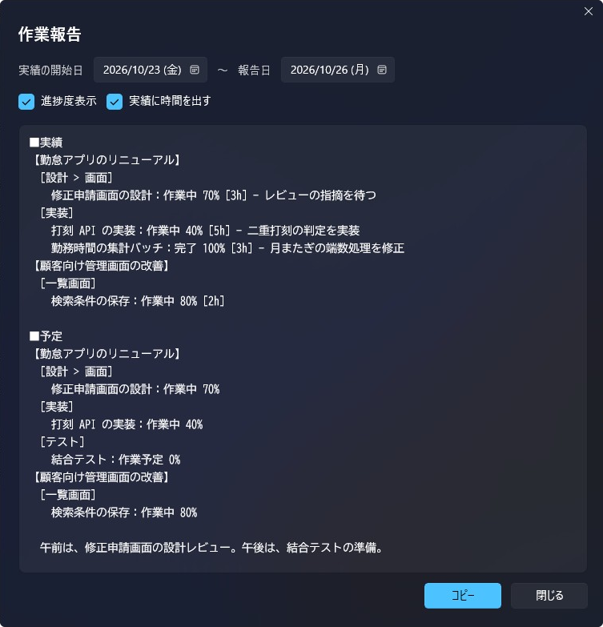
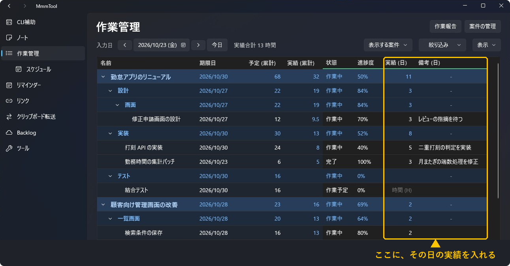
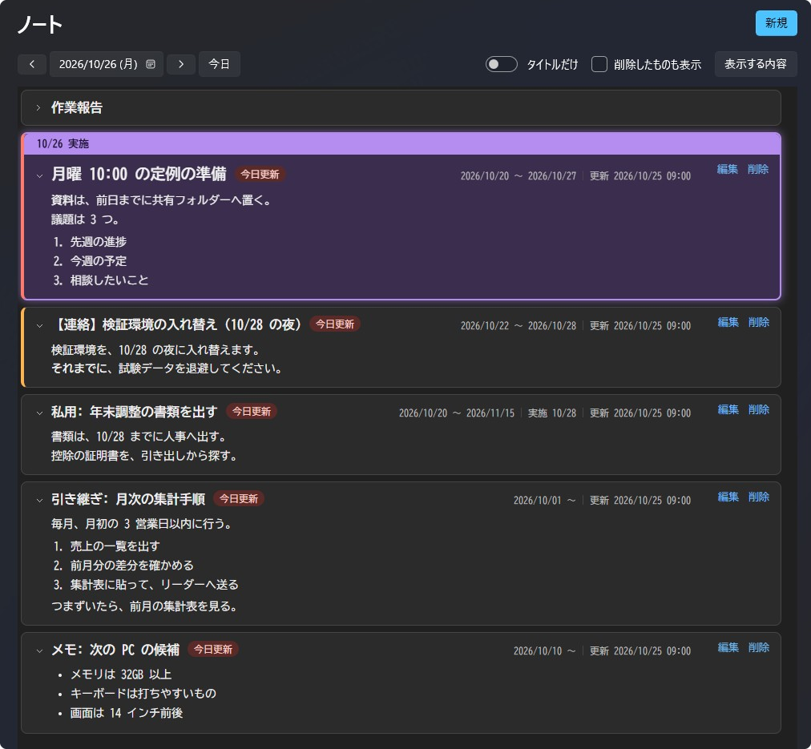
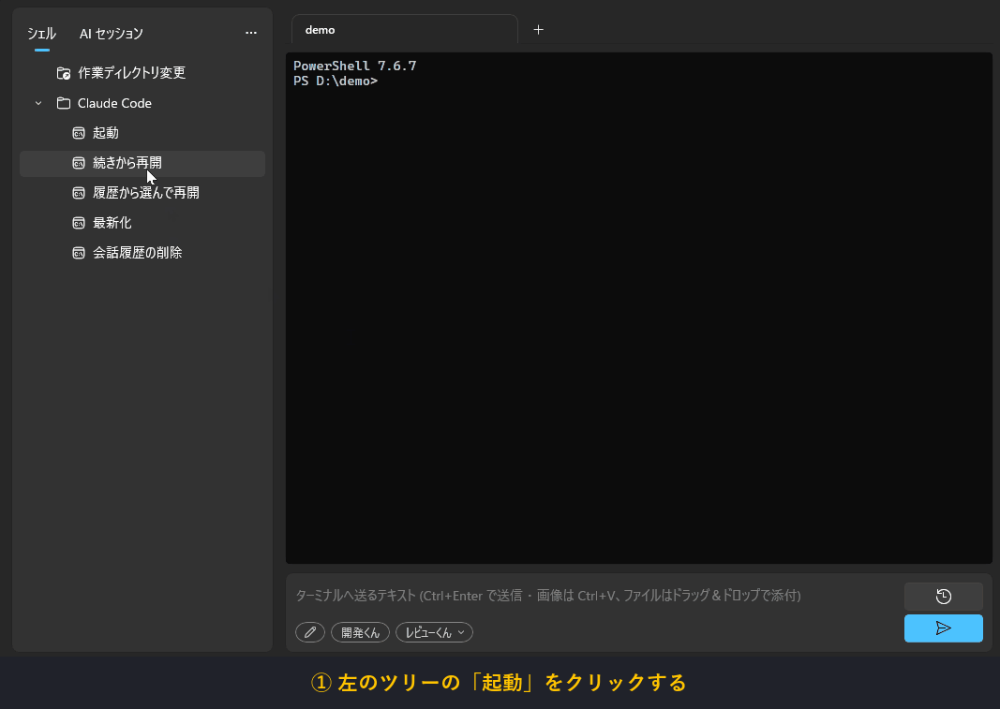
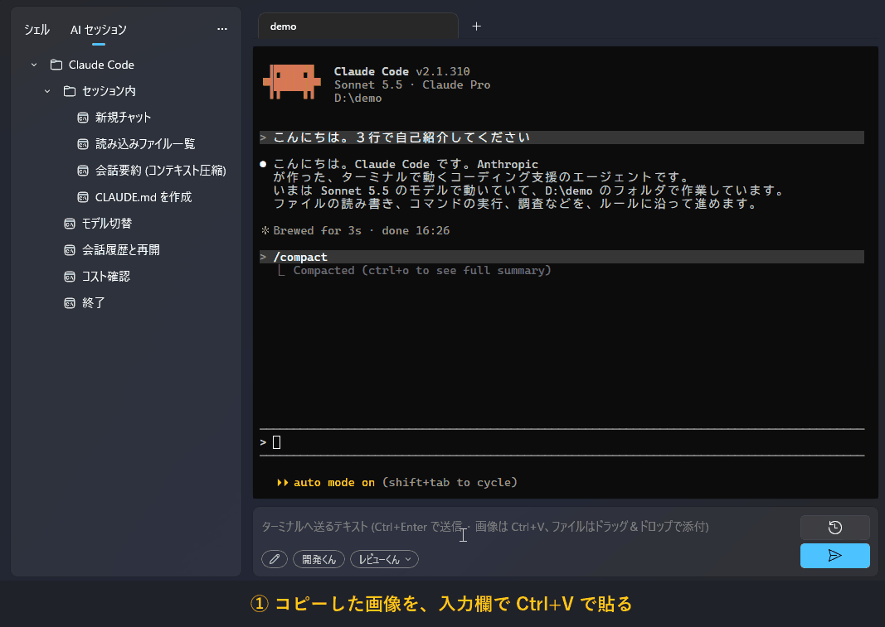
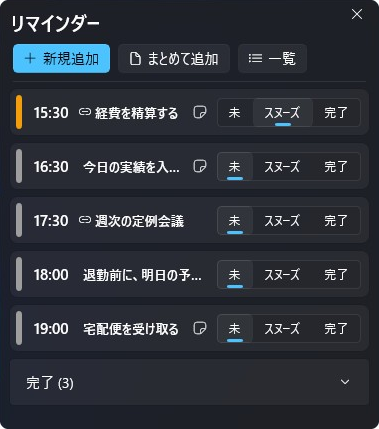
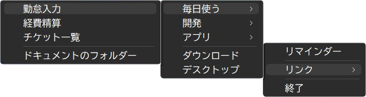
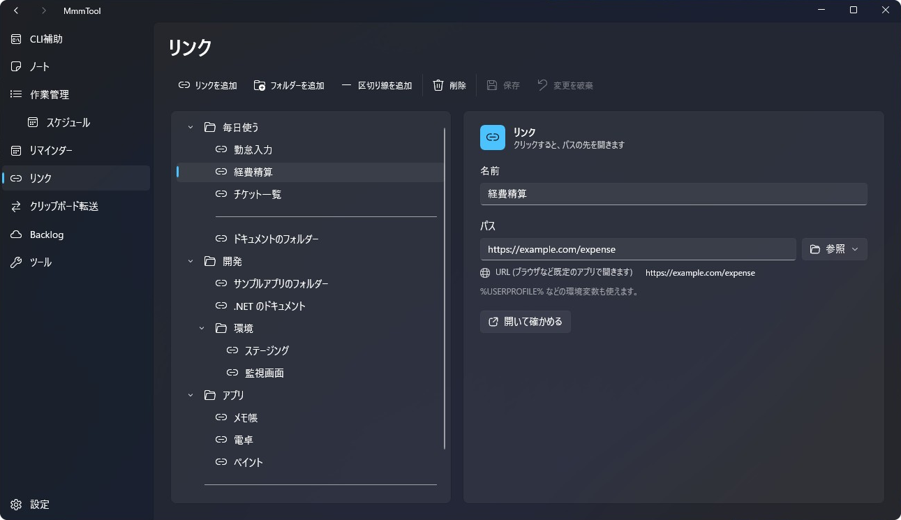

# MmmTool

**報告のたびに、前日に何をしたか思い出して書くのを、やめたい人へ。**

その日の実績は、一覧のセルにそのまま入れておきます。  
報告のときは、ボタンを押して、報告用の文をコピーします。

MmmTool は、Windows 11 のタスクトレイに常駐するツールです。



ほかに、ノート・CLI補助・リマインダー・リンクがあります。

## 主な機能

### 作業管理

案件・グループ・作業を、木構造で整理します。  
実績と予定は、スケジュールで、日付を横に並べて見られます。



### ノート

やることや連絡を、いつからいつまで見るかを決めて、書いておきます。  
日付のページを開くと、その日に見るものが、1 枚に全部並びます。

作業管理で入力した、その日の作業報告 (実績と予定)も、カードの上に出せます。  
実施日には、通知も出ます。

サーバー保存なら、複数人で共有して、引き継ぎの資料にもできます。  
ノートごとに、全員に見せるか、自分だけにするかを選べます。



### CLI補助

Claude Code・Kiro を、アプリの中のターミナルで使います。  
フォルダーごとに、タブを開けます。

CLI補助は、初期状態ではオフです。  
設定の「機能」でオンにします。

#### コマンドは、クリックで送る

左のツリーの項目をクリックすると、コマンドがターミナルに送られます。



#### 画像は、Ctrl+V で添付する

画像は入力欄で Ctrl+V、ファイルはドロップで添付できます。  
CLI ごとのキー操作を、覚える必要はありません。



### リマインダー

完了にするまで、最前面で通知を繰り返します。  
フォーカスもキー入力も奪いません。  
通知の読み上げもできます。



通知は、次のように出ます。


### リンク

URL・フォルダー・ファイル・アプリを、階層に整理して、トレイのメニューから開きます。





### その他の補助ツール

- **クリップボード転送**: ファイルを、リモートデスクトップなどでクリップボードを共有している別の PC へ渡します。
- **Backlog**: Backlog の共有ファイルの一覧を見て、ダウンロードできます。
- **ツール**: 小さな便利ツールを集めたページです。今は、文字コードになった URL を日本語に戻せます。

### サーバー保存なら、こんなこともできます

保存先をローカルからサーバー (SQL Server)に変えると、次のことができます。  
サーバー側の準備が必要なので、使いたいときは管理者に相談してください。

- リマインダーと作業管理のデータを、複数の PC・複数の人で共有できます。
- 作業管理で、作業ごとに担当者を付けて、「自分の担当だけ」に絞れます。
- 管理者が通知の送信を用意していれば、リマインダーを、スマホ (ntfy)や Discord、Web 版にも通知できます。
- 他のユーザーと、会話の形で、短いメッセージをやり取りできます。
- ノートを、複数の人で共有できます。ノートごとに、全員に見せるか、自分だけにするかを選べます。
- iPhone のホーム画面のアプリ (Web 版)から、ノートとメッセージを使えます。リマインダーは、通知の一覧に出ます。ログインはパスキーです。

## ダウンロード

[Releases](https://github.com/Mimumumimu/MmmTool/releases) から zip をダウンロードして、展開するだけで使えます。  
インストールは不要です。  
普段はタスクトレイにいて、ウィンドウを閉じても常駐し続けます。  
使わない機能は、リンクとリマインダーを除いて、設定でオフにできます。

> [!WARNING]
> **ダウンロードしたとき、Microsoft Defender が「ウイルスを検出しました」と表示して、zip を削除することがあります。**
>
> MmmTool にコード署名が無いため、危険ではないのに危険と判定される誤検知です。`Trojan:Script/Wacatac.B!ml` などと表示されます。Microsoft には、誤検知として報告しています。
>
> MmmTool は、利用者が設定した接続先 (データの保存先のサーバーや Backlog など)以外へは通信しません。ソースコードはこのリポジトリで公開しています。
>
> 削除されたときは、Windows セキュリティの「ウイルスと脅威の防止」→「保護の履歴」で該当の項目を開き、「操作」から「デバイス上で許可」を選んでから、zip をダウンロードし直してください。

### 動作環境

- Windows 11(x64)
- [.NET 10 Desktop Runtime](https://dotnet.microsoft.com/download/dotnet/10.0)(x64)
- [Windows App Runtime 2.5](https://learn.microsoft.com/windows/apps/windows-app-sdk/downloads)(x64)
- [Microsoft Edge WebView2 ランタイム](https://developer.microsoft.com/microsoft-edge/webview2/)(Windows 11 には標準で入っています)
- 日本語の音声 (リマインダーの読み上げを使うとき)
  - 日本語版の Windows には標準で入っています。外国語版の Windows では、設定の「言語と地域」で日本語を追加すると入ります。
- PowerShell 7(任意)
  - 入っていれば、ターミナルで優先して使います。
- WSL(任意)
  - CLI補助で、WSL に入れた Claude Code・Kiro を使うときに入れます。
  - 会話履歴の削除の補助スクリプトには、WSL の中に Python 3 が要ります。Ubuntu には標準で入っています。

ランタイムはアプリに同梱していません。  
.NET と Windows App Runtime は、入っていなければ `MmmTool.exe` を起動したときに案内のダイアログが出るので、そこからダウンロードしてインストールできます。

### 導入

1. zip を展開します。できたフォルダーに、アプリ本体の `MmmTool.exe` と、説明書 `README.txt`・`操作説明.html` が並んでいます。
2. `MmmTool.exe` を開きます。ウィンドウは出ず、タスクトレイにアイコンが出ます。

- 展開したフォルダーは、好きな場所 (例: `D:\Tools\MmmTool`)へ移して使えます。フォルダー名も、好きな名前に変えられます。ただし、**他の人が書き込めるフォルダーには置かないでください**。理由は「[データ保存場所](#データ保存場所)」にあります。
- **`Data` フォルダーを上書きしないでください。** 入力したデータはすべて `Data` フォルダーに保存されます。`Data` フォルダーは、`MmmTool.exe` を起動したときに、`MmmTool.exe` と同じフォルダーに作られます。ダウンロードしたばかりの状態では、まだありません。起動したフォルダーごとに、別々の `Data` ができます。
  - `MmmTool` 一式をコピーするとき、コピー先に `Data` フォルダーがあると、Windows が「置き換えますか」といった確認を出します。`Data` フォルダーが置き換わると、元のデータは消えて戻せません。
  - 別の場所へ移すときや新しいバージョンに替えるときは、これまで使ってきた `Data` フォルダーを先にバックアップしてください。`Data` フォルダーを丸ごと別の場所にコピーしておけば、上書きしてしまっても元に戻せます。
- `Lib` フォルダーの中身を動かしたり、`MmmTool.exe` と同じフォルダーへ移したりしないでください。起動できなくなります。

### アンインストール

MmmTool のフォルダーを、丸ごと削除してください。  
`%TEMP%\MmmTool\` が残っていたら、それも削除してください。  
Backlog の API キーを登録していたときは、Windows の資格情報マネージャー (「Windows 資格情報」の汎用資格情報 `MmmTool.Backlog`)から、その項目も削除してください。

## 使い方

1. `MmmTool.exe` を開くと、タスクトレイにアイコンが出ます。左クリックでメインウィンドウを開きます。
2. 左のメニューから機能を選びます。初期状態では、CLI補助・クリップボード転送・Backlog は出ません。使う機能は、設定の「機能」でオンにします。
3. ウィンドウを × で閉じてもトレイに残ります。完全に終了するときは、トレイアイコンの右クリックメニューから「終了」を選びます。未保存の編集内容は破棄されます。

機能ごとの使い方は、展開したフォルダーの `操作説明.html` にまとめています。  
ブラウザーで開いてください。

### 定型コマンドを自分で書く

CLI補助の定型コマンドは、`Data/CliCommands.json` で編集できます。  
アプリを終了してから直してください。  
`shell`(シェルで打つコマンド)と `session`(AI エージェントのセッション内で打つコマンド)の 2 つのツリーがあり、`children` を持つ項目はフォルダー、`command` を持つ項目はクリックで送信するコマンドです。

```json
{
  "environment": "windows",
  "shell": [
    {
      "label": "Claude Code",
      "children": [
        { "label": "起動", "command": "claude", "switchTo": "session", "focus": "input" }
      ]
    }
  ],
  "session": []
}
```

- `environment`: コマンドを動かす環境です。`"windows"` か `"wsl"` を書きます。省略すると Windows です。変えるときは、書き換えるより、左の一覧の右上の「⋯」メニューの「定型コマンドを初期化…」で選び直してください。
- `switchTo`: 送信後に切り替えるタブです。`"shell"` か `"session"` を書きます。省略すると切り替えません。
- `focus`: 送信後のフォーカスの移動先です。`"terminal"` か、送信欄を指す `"input"` を書きます。省略すると移しません。
- コマンド中の `{AppDir}` は、送信時に `MmmTool.exe` のあるフォルダーに置き換わります。引用符は付かないので、`"{AppDir}\tool.ps1"` のように自分で囲んでください。WSL では `/mnt/d/...` の形になるので、区切りは `/` で書きます。

## データ保存場所

`MmmTool.exe` と同じフォルダーの `Data` フォルダーに保存します。  
手で直すときは、アプリを終了してから行ってください。  
起動中は、メモリ上の内容で上書きされることがあります。

**置き場所の注意:** `Data/CliCommands.json` の定型コマンドは、クリックするとターミナルへ送られて実行されます。  
`Data` フォルダーを他の人が書き込めるフォルダーに置くと、そのコマンドを書き換えられて、任意のコマンドを実行されるおそれがあります。  
自分だけが書き込めるフォルダー (ユーザーフォルダーの下など)に置いてください。

| ファイル | 内容 |
| --- | --- |
| `Data/CliCommands.json` | CLI補助の定型コマンド。無ければ既定の内容で作成 |
| `Data/CliSettings.json` | CLI補助の最後の作業ディレクトリ・履歴・開いているタブと選んでいるタブ |
| `Data/CliQuickMessages.json` | CLI補助の入力欄に出す、よく使う文とグループ。編集画面で保存したときに作成 |
| `Data/CliFocusTriggers.json` | CLI補助で、ターミナルの出力に出たらターミナルへフォーカスを移す文字列。編集画面で保存したときに作成 |
| `Data/Links.json` | リンクの構成。無ければ空で作成 |
| `Data/MmmTool.db` | 作業管理とノートのデータ (SQLite)。無ければ最初に使うときに作成。壊れていたら `MmmTool.broken-日時.db` へ名前を変えて残し、作り直す |
| `Data/Reminders.json` | リマインダー本体 |
| `Data/ReminderStates.json` | リマインダーの対応状態 |
| `Data/AppSettings.json` | アプリ共通の設定 (ウィンドウ位置・スヌーズ間隔・読み上げの音量・作業管理の表示の設定・リマインダーのまとめて追加で前回選んだ内容など。キーの一覧は [docs/specs/storage.md](docs/specs/storage.md)) |

JSON として読めないファイルは、`名前.broken-yyyyMMdd-HHmmss.json` に名前を変えて同じフォルダーに退避し、新しく作り直します。  
退避したファイルは自動では消えないので、必要な内容を戻したら削除してください。

### サーバー保存のとき

設定ページの「保存先」(または、保存先をまだ選んでいない初回の起動で出る「保存先の選択」の画面)で、保存先を「サーバー」にして、接続を入力します。  
保存先の変更は、アプリの再起動で反映されます。

- リマインダー・作業管理・ノートが、`Data` フォルダーではなく SQL Server に保存されます。ローカルの JSON と SQLite は使いません。
- 接続の設定 (サーバー名・データベース名・ユーザー名など)は `Data/AppSettings.json` の `Database.*` に、パスワードは Windows の資格情報マネージャー (`MmmTool.Database`)に保存します。通信は常に暗号化します。
- 起動時にログインが必要です。最初は「新規登録」でログイン名・表示名・パスワードを決めます。ログイン情報は、この PC(Windows アカウントごと)の資格情報マネージャーに覚え、次の起動からは自動でログインします。
- 表は、`src/Data/MmmTool.Data.SqlServer/Sql/` の `001_CreateTables.sql` から番号の順に流して作ります。アプリが使うログインには、`dbo` スキーマの読み書き (`SELECT`・`INSERT`・`UPDATE`・`DELETE`)だけを与えます。

接続・ログイン・パスワードの再設定などの詳しいことは、[docs/specs/database.md](docs/specs/database.md) と [docs/specs/settings.md](docs/specs/settings.md) にあります。

### そのほかのファイル

実行すると、次の場所にもファイルが作られます。

- `%TEMP%\MmmTool\session_日時\`: CLI補助で貼り付けた画像など、元がファイルではない添付。タブを閉じるとき・終了時に削除します。ドロップしたファイルはコピーしないので、ここには入りません。
- WSL の `/tmp/MmmTool/session_日時/`: CLI補助を WSL で使うときに、`%TEMP%` の代わりに使う、貼り付けた画像の置き場所。
- WSL の `~/.local/share/Trash/`: WSL 版の「会話履歴の削除」で消した履歴の移動先 (Linux のごみ箱)
- `Cache\MessageCache.db`: メッセージの控え。会話ごとに、新しい順の 200 件までを、ログインした人ごとに分けて持ちます。消しても、次に開いたときに作り直されます。
- `Cache\WebView2\`: ターミナルの画面 (WebView2)のキャッシュ。消しても、次に開いたときに作り直されます。他の人が書き込めるとキャッシュを書き換えられるおそれがあるので、`Data` フォルダーと同じく、自分だけが書き込めるフォルダーに置いてください。
- `Data\Logs\`: エラーのログ。自動では消えません。例外のスタックトレースに、ユーザー名を含むパスが入ることがあるので、ログを他の人に渡すときは、中身を確かめてください。

`%TEMP%` と WSL の中のファイルのほかは、`Data` と `Cache` の下に作られます。  
`MmmTool.exe` のフォルダーの外には書きません。  
ただし Backlog の API キー・サーバーのパスワード・サーバー保存のログイン情報は、`Data` ではなく Windows の資格情報マネージャーに保存します。

## ライセンス

このプロジェクトは [MIT License](./LICENSE.txt) のもとで公開されています。  
記載の製品名・サービス名は、各社の商標または登録商標です。  
各社とは関係ありません。

同梱している外部ライブラリ (NuGet パッケージを含む)のライセンスと通知の全文は、配布物の `Assets\Licenses\THIRD-PARTY-NOTICES.txt` にまとめています。  
発行のたびに、配布物に入るパッケージから自動で作ります。  
リポジトリに直接入れているものは、次のファイルです。

- xterm.js(MIT License): [`external/MmmSdk/MmmSdk.WinUI/Components/Terminal/Assets/xterm.LICENSE.txt`](./external/MmmSdk/MmmSdk.WinUI/Components/Terminal/Assets/xterm.LICENSE.txt)
- @xterm/addon-fit(MIT License): [`external/MmmSdk/MmmSdk.WinUI/Components/Terminal/Assets/addon-fit.LICENSE.txt`](./external/MmmSdk/MmmSdk.WinUI/Components/Terminal/Assets/addon-fit.LICENSE.txt)

---

# 開発者向け

ここから下は、ソースコードからビルドする人・開発に加わる人向けの説明です。

## 技術スタック

- .NET 10(`net10.0-windows10.0.19041.0`)
- WinUI 3(Windows App SDK 2.5)
- CommunityToolkit.Mvvm
- CommunityToolkit.WinUI.Controls.Segmented(リマインダーの対応状態の切り替え)
- CommunityToolkit.WinUI.Controls.SettingsControls(設定ページのカード)
- Microsoft.Extensions.Hosting(Generic Host による DI)
  - 設定・ログの既定は無効
- WebView2 + [xterm.js](https://xtermjs.org/) 6.0.0 / addon-fit 0.11.0(ターミナル描画)
- Win32 API の直接呼び出し (ConPTY・`Shell_NotifyIcon` によるトレイアイコンなど)
  - WinForms には依存しません
- 共有部品 [MmmSdk](https://github.com/Mimumumimu/MmmSdk)(Git サブモジュール)

## 開発環境

- .NET 10 SDK
- Visual Studio 2026 以降 (「WinUI アプリケーション開発」ワークロード)
- 実行には、上の「[動作環境](#動作環境)」のランタイムも要ります。フレームワーク依存の構成のためです。

## 取得方法

共有部品 [MmmSdk](https://github.com/Mimumumimu/MmmSdk) を Git サブモジュール (`external/MmmSdk`)として取り込んでいます。  
clone するときはサブモジュールも一緒に取得してください。

```powershell
git clone --recurse-submodules https://github.com/Mimumumimu/MmmTool.git
```

すでに clone 済みで `external/MmmSdk` が空のときは、次を実行します。

```powershell
git submodule update --init --recursive
```

## ビルドと実行

構成は x64 のみです。  
ソリューションは 5 つあります。

| ソリューション | 内容 |
| --- | --- |
| `MmmTool.slnx` | MmmTool 本体 |
| `MmmBatch.slnx` | サーバー用の別アプリ MmmBatch(リマインダーとメッセージの外部送信) |
| `MmmToolAdmin.slnx` | サーバーモードの管理ツール MmmToolAdmin(ユーザーの一覧と、Web 版の登録用コードの発行と、ユーザーごとの機能の利用) |
| `MmmToolWeb.slnx` | Web 版 MmmToolWeb(iPhone のホーム画面から使う、サーバーと画面) |
| `MmmToolAll.slnx` | 上の 4 つをまとめたもの。共通のプロジェクトを直したあとの、ビルドの確認用 |

```powershell
dotnet restore .\MmmTool.slnx
dotnet build .\MmmTool.slnx
```

`MmmBatch.slnx` などの、ほかのソリューションも同じ手順です。  
共通のプロジェクトを直したときは、4 つをまとめた `MmmToolAll.slnx` がビルドできることを確かめてください。

ビルドの共通設定はリポジトリ直下にまとめています。  
`external/MmmSdk` は、SDK 自身の同名ファイルを使います。

| ファイル | 内容 |
| --- | --- |
| `Directory.Build.props` | 全プロジェクト共通の設定 (Nullable・XML ドキュメントコメントの検査・コードスタイルのビルド時検査など) |
| `Directory.Packages.props` | NuGet パッケージのバージョン (中央パッケージ管理。csproj にはバージョンを書きません) |
| `.editorconfig` | コードスタイル。未使用の using などはビルド時に警告になります |

実行は Visual Studio で `MmmTool.slnx` を開き、`MmmTool` プロジェクト (起動プロファイル「MmmTool」)を F5 で起動します。  
起動してもウィンドウは出ず、タスクトレイにアイコンが出ます。

### 配布用の発行

Visual Studio では、ソリューション エクスプローラーで `MmmTool` プロジェクトを右クリックし、「発行」を選びます。  
発行プロファイル `win-x64`(構成は Release | x64)を選んで「発行」を押します。

コマンドで発行すると、Visual Studio と同じ結果になります。

```powershell
dotnet publish .\src\App\MmmTool\MmmTool.csproj -p:PublishProfile=win-x64
```

取得 (`git pull`・サブモジュールの更新)から発行までを 1 回で行うときは、`scripts\00_update_and_publish.bat` を実行すると、MmmTool・MmmBatch・MmmToolWeb・MmmToolAdmin の4つを発行します。  
MmmTool だけ・MmmBatch だけ・MmmToolWeb だけ・MmmToolAdmin だけを発行するときは、`01_update_and_publish_tool.bat`・`21_update_and_publish_batch.bat`・`11_update_and_publish_web.bat`・`29_update_and_publish_admin.bat` を実行します。  
どこにクローンしても動き、途中で失敗するとその時点で止まります。

発行すると、バージョンごとのフォルダー `src/App/MmmTool/bin/Release/publish/MmmTool_<バージョン>/` ができます。  
バージョンは `Directory.Build.props` の `Version` で決まります。  
このフォルダーをそのままコピーして配布します。  
インストーラーはありません。

```
MmmTool_<バージョン>\
  MmmTool.exe               ← アプリ本体 (このフォルダーごと、好きな場所へコピーして使う)
  README.txt                ← 利用者向けの説明書 (最初に・機能一覧・動作環境・データの場所・変更履歴)
  操作説明.html             ← 機能ごとの使い方 (ブラウザーで開く)
  Assets\Licenses\LICENSE.txt               ← MmmTool のライセンス (MIT)
  Assets\Licenses\THIRD-PARTY-NOTICES.txt   ← 同梱しているライブラリのライセンスと通知の全文
  Lib\ など
```

- `Version` を上げずに発行し直すと、同じバージョンのフォルダーに、前回のファイルを消さずに上書きします。前のバージョンにだけあったファイルを残したくないときは、発行の前にそのフォルダーを消してください。
- `README.txt` の元は `src/App/MmmTool/Distribution/README.txt`、`LICENSE.txt` はリポジトリ直下のものです。`THIRD-PARTY-NOTICES.txt` は、発行のたびに、配布物に入るパッケージから自動で作ります。
- `MmmTool.exe` の横のフォルダーは `Assets`(配布物)と `Lib`(使っているライブラリの DLL)だけです。実行すると `Data`(アプリが書くもの)ができます。`Lib` の DLL の場所は `MmmTool.deps.json` に書いてあるので、`Lib` を動かしたり、DLL を `MmmTool.exe` の横へ移したりしないでください。起動できなくなります。

発行の設定と配布物の決まりは、[docs/build-and-distribution.md](docs/build-and-distribution.md) にあります。

## MmmSdk を更新するとき

SDK を直したら、先にサブモジュールの中でコミット・push し、そのあと MmmTool 側で「新しいコミットを指す」変更をコミットします。  
SDK 側のブランチは、MmmTool 側と同じ種類にします。  
通常の開発は `develop` です。

```powershell
cd external/MmmSdk
# …変更をコミットして push…
cd ../..
git add external/MmmSdk
git commit
```

SDK の最新を取り込むときは、次を実行します。

```powershell
git submodule update --remote external/MmmSdk
```

## プロジェクト構成

| フォルダー | 内容 |
| --- | --- |
| `src/Plugins/MmmTool.<機能>.Core/` | 機能の、UI に依存しない層 (`net10.0`)。保存するデータ・保存先のインターフェース・処理を置き、JSON での保存は `Json/` に置く。機能は `Backlog`・`CliAssist`・`ClipboardTransfer`・`Links`・`Messages`・`Notes`・`Reminders`・`Tools`・`WorkItems` |
| `src/Plugins/MmmTool.<機能>/` | 機能の WinUI 3 ライブラリ。直下に機能の入口 (`<機能>Plugin`)・起動時の準備などのつなぎ、`Main/` に入口の画面、そのほかの画面は 1 画面 1 フォルダー (View・ViewModel・その画面の Windows 依存の処理)にまとめている |
| `src/App/MmmTool/Features/` | ホストが持つ機能のフォルダー (`Settings/`・`Users/`・`Database/`) |
| `src/App/MmmTool/Shell/` | 画面の枠。直下に DI への登録とナビゲーションの型、`Main/` にメインウィンドウ・サイドバー (タスクトレイの仕組みは SDK) |
| `src/App/MmmBatch/` と `src/Plugins/MmmBatch.*` | サーバー用のアプリ MmmBatch(`MmmBatch.slnx`)。リマインダーとメッセージを ntfy・Discord・Web 版通知へ送る。外部へ送る処理は、ここだけにあり、MmmTool には入らない |
| `src/App/MmmToolAdmin/` と `src/Plugins/MmmToolAdmin.*` | サーバーモードの管理ツール MmmToolAdmin で、ソリューションは `MmmToolAdmin.slnx`。ユーザーの一覧と、Web 版の登録用コードの発行と、ユーザーごとの機能の利用 |
| `src/App/MmmToolWeb/` と `src/Plugins/MmmToolWeb.*` | Web 版 MmmToolWeb で、ソリューションは `MmmToolWeb.slnx`。サーバー (`Server`)と、ブラウザで動く画面 (Blazor WebAssembly の `Client`)から成り、ノートとメッセージを使え、通知の一覧にリマインダーも出る。ログインはパスキー (`src/Auth/`) |
| `src/Data/` | DB のコード。`MmmTool.Data*`(保存先・接続の入力欄)・`MmmBatch.Data.SqlServer`・`MmmToolAdmin.Data.SqlServer`・`MmmToolWeb.Data.SqlServer` |
| `external/MmmSdk/` | 共有部品 (Git サブモジュール)。設定ストア・ウィンドウ位置の保存・通知ダイアログ・確認ダイアログ・ファイル/フォルダー選択・擬似モーダル・多重起動の防止・タスクトレイ・時刻入力欄・IME 操作・添付の一時保存など |
| `docs/images/` | この README で使う画像 |

機能を足すときは、`src/Plugins/MmmTool.<機能>.Core/` と `src/Plugins/MmmTool.<機能>/` を作り、`MmmTool` から参照して、`App.xaml.cs` で `AddFeaturePlugin<<機能>Plugin>(order: n)` を 1 行呼びます。  
`order` はサイドバー・トレイ・設定の並び順の値で、小さいほど先です。  
トレイだけ別の順にするときは `trayOrder: n` も渡します。  
機能を外すときは、参照と 1 行を削除します。  
使わない機能を含まない配布物を作れます。  
詳しくは [docs/architecture.md](docs/architecture.md) にあります。

## ドキュメント

設計と仕様は `docs/` にまとめています。

| ファイル | 内容 |
| --- | --- |
| [docs/architecture.md](docs/architecture.md) | 全体構成 (プロジェクト・フォルダー・DI・起動と終了・エラーの扱い)と、その決定の理由 |
| [docs/build-and-distribution.md](docs/build-and-distribution.md) | ビルドの共通設定・配布 (発行・配布物・ライセンス)と、その決定の理由 |
| `docs/specs/` | 機能ごとの仕様と実装メモ、決定の理由 (Backlog・CLI補助・クリップボード転送・リンク・メッセージ・MmmBatch・ノート・リマインダー・ツール・トレイとメイン画面・設定・保存・DB・作業管理) |
| [docs/todo.md](docs/todo.md) | 未実装・残りの作業 |
| `external/MmmSdk/docs/` | 共有部品 (JSON の保存・設定ストア・通知ダイアログ・確認ダイアログ・タスクトレイ・ConPTY・ターミナル・コントロール)の仕様と、構成の決定の理由 |

## バージョン

バージョンは `Directory.Build.props` の `Version` で決めます。  
ファイル・アセンブリのバージョンは、末尾に 0 を足した 4 桁になります。  
変更履歴は、配布物の説明書の「変更履歴」に書いています。  
説明書の元は `src/App/MmmTool/Distribution/README.txt` です。
